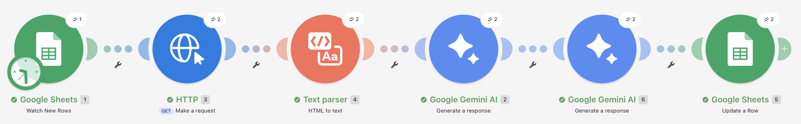
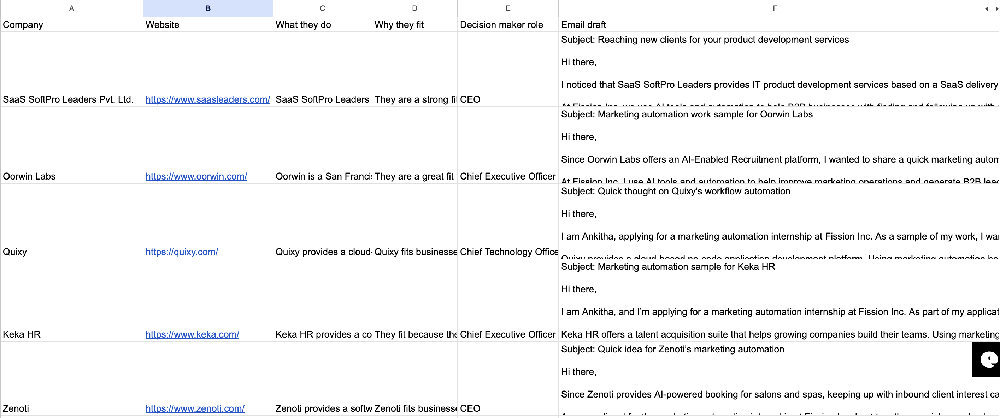

# AI Lead Research and Outreach Automation

An automation built with **Make**, **Google Sheets** and the **Gemini API** that does the first draft of B2B prospect research and outreach.

## What it does
1. Reads a company name and website from a Google Sheet
2. Fetches the website and converts it to plain text
3. Uses Gemini to write a company summary, a fit assessment and a suggested decision-maker role
4. Uses Gemini again to draft a short outreach email
5. Writes the results back to the sheet (a Sheets formula splits the AI output into columns)

Tested on 5 B2B software companies.

## Screenshots

## What I learned
- **Prompts:** separating facts (from the website only) from judgement (best estimate) stopped the AI answering "not sure" to everything
- **Quality:** company-size rules made contact roles realistic; banning placeholders and unsupported claims improved the emails
- **Reliability:** I handled free-tier rate limits and a timeout by shortening input text, limiting batch size and switching models

## Tools
Make, Google Sheets, Gemini API, HTTP requests, prompt engineering

## Author
Ankitha Suttoju, B.Tech CSE (AI/ML), ACE Engineering College, Hyderabad
